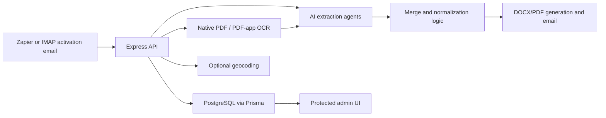
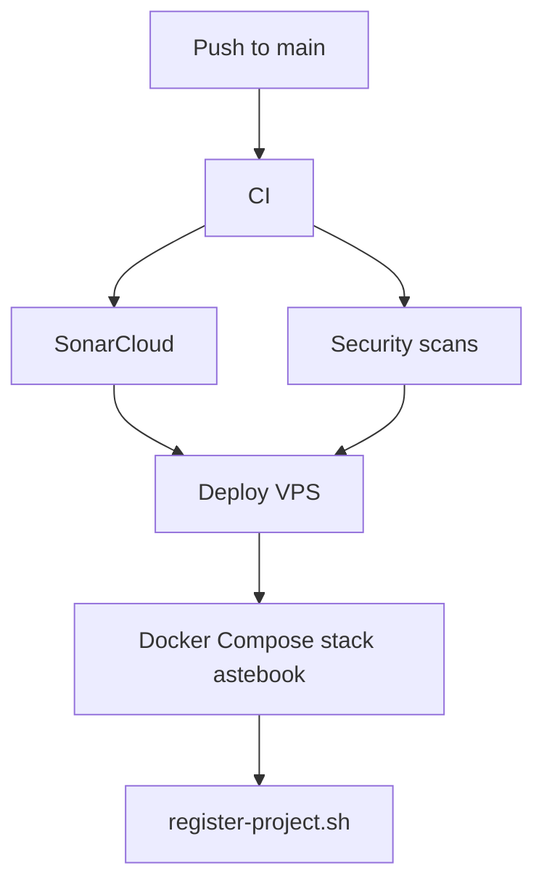

# Architecture

Astebook uses a minimal frontend/backend split. It is one deployable Node/Express service with a protected admin UI, PostgreSQL/Prisma operational storage, AI/OCR extraction and optional direct mailbox ingestion.

## Components

- `backend/server.js`: HTTP API, upload handling, route registration and runtime orchestration.
- `backend/lib/app_config.js`: first-admin bootstrap plus DB-backed runtime settings in production.
- `backend/lib/db.js`: Prisma client for PostgreSQL-backed state.
- `backend/lib/processing_log.js`: Prisma-backed processing event and step store.
- `backend/lib/extraction_pipeline.js`: text acquisition, OCR, AI extraction, merge, logging and auto-send handoff.
- `backend/lib/ai.js`: AI provider integration, prompt execution and deterministic fallbacks.
- `backend/ai_agents/**`: document-level agents, field agents and email interceptor logic.
- `backend/lib/pdf.js`: native PDF text parsing.
- `backend/lib/pdf_app.js`: PDF-app OCR integration, retry/polling and OCR diagnostics.
- `backend/lib/ocr_input_store.js`: temporary OCR input URL generation and token masking.
- `backend/lib/merge_json.js` and `backend/lib/extraction_result.js`: domain merge rules, missing-field checks and final result shaping.
- `backend/lib/document_builder.js`: DOCX/PDF output generation.
- `backend/lib/document_email.js`: generated document email and report composition.
- `backend/lib/mailbox_index.js`, `backend/lib/mailbox_browser.js`, `backend/lib/email_watcher.js`: DB-backed mailbox indexing, sync/backfill and watcher ingestion.
- `backend/lib/mailbox_auto_processor.js`: scheduled processing for indexed mailbox rows.
- `backend/scrapers/`: supporting extraction scripts.
- `backend/tests/`: backend/API tests.
- `frontend/src`: protected React admin UI served by the backend under `/admin`.
- `scripts/`: diagnostics, lint helpers and migration/backfill scripts.

## Runtime Flow

1. Zapier or the IMAP watcher creates an activation processing event.
2. The pipeline normalizes email text and attachment descriptors.
3. Attachments are parsed through native DOCX/PDF readers or PDF-app OCR when native text is insufficient.
4. AI agents extract announcement, proposal, commission and practice-code fields.
5. Deterministic fallbacks fill known structured fields when prompt output is incomplete.
6. Announcement/proposal data is merged and missing fields are collected.
7. The result is persisted to the processing event and visible in `/admin`.
8. When document, SMTP and recipient settings are complete, Astebook generates and sends the document email.

## AI Extraction

AI extraction is centered on `backend/lib/ai.js` and `backend/ai_agents/**`.

Main scopes:

- `annuncio`: announcement fields such as practice code, address, sale type, sale date/time, prices, deposit deadlines, surface, floor, elevator, state, category and update date.
- `proposta`: proponent identity, property address, offered price, deposit, IBAN, deadlines and cadastral fields.
- `provvigione`: commission/provvigione extraction.

Human corrections are saved through extraction feedback APIs and can be injected as scoped AI memory for future prompts. When adding an extracted field, update the relevant field registry, fallback logic, merge/output handling, tests and API/output documentation.

## OCR and PDF-app

Astebook first tries native PDF text extraction. If text is missing or insufficient, it creates a temporary OCR input URL and sends that URL to PDF-app.

Important rules:

- Temporary OCR input URLs are intentionally unauthenticated so PDF-app can fetch them, but tokens are random and must be masked in logs.
- PDF-app authorization uses the raw API key, with no `Bearer` prefix.
- Verified async polling uses `GET https://api.pdf-app.net/async_jobid_check` with JSON body `{"job_id":"..."}`.
- Do not use `/async_jobid_check/<jobId>` or `?job_id=...` for the verified PDF-app contract.
- Successful multipage OCR is cached with parser version `pdf_app_multi_page_v1`.
- Empty async success is diagnosed as `ocr_empty_result` and is not cached as valid OCR.
- Diagnostics must not log `PDF_APP_API_KEY`, full OCR input tokens or full authorization headers.

Relevant tests:

- `backend/tests/pdf_app_diagnostics.test.js`
- `backend/tests/ocr_input_store.test.js`
- `backend/tests/ocr_input_self_test.test.js`
- `backend/tests/extraction_pipeline.test.js`

## Mailbox Ingestion

Mailbox ingestion is optional and controlled by runtime settings. In production, mailbox listing is DB-backed through `mailbox_messages`; the admin sidebar should read indexed rows instead of opening live IMAP during normal load.

Key behavior:

- `email_watcher.js` starts with the server and stays idle unless `email_watcher_enabled=true`.
- The watcher uses persistent `last_uid` baseline state to avoid processing historical mail on first activation.
- Accepted messages are cached and indexed with `status="mailbox_indexed"` and `processing_status="mailbox_indexed"`.
- Auto-process candidates are gated by `status="mailbox_indexed"`, `event_id IS NULL`, `processed=false`, UID present and sender not disallowed.
- DB mode claims a row before processing by moving it to `processing`.
- Failed rows should not be retried forever unless explicitly selected by the query and claim policy.

Relevant tests:

- `backend/tests/email_watcher.test.js`
- `backend/tests/mailbox_index.test.js`

## Frontend Admin

The admin UI is served by Express under `/admin` and remains protected by server-side login. Login, setup and recovery pages are rendered by `backend/routes/admin_auth.js` before the React admin shell is served.

Main frontend entry points:

- `frontend/src/App.jsx`: dashboard shell.
- `frontend/src/ConsoleAdmin.jsx`: `/admin/settings` page.
- `frontend/src/adminClient.js`: dashboard initializer.
- `frontend/src/admin/**`: API client, event list, detail controller, settings controller, learning panel, workflow rendering, structured views, file sections, shell behavior and toasts.

Settings is a protected page at `/admin/settings`, not a modal. Vite output is written to `frontend/dist` and served by Express.

## Scripts and Diagnostics

NPM scripts are defined in `package.json`.

Important repository scripts:

- `scripts/check-js.js`: JavaScript syntax checker used by `npm run lint`.
- `scripts/import-processing-events-jsonl.mjs`: legacy processing-event JSONL import/backfill; requires `DATABASE_URL`.
- `scripts/test_pdf_app_ocr.js`: simple public-PDF OCR diagnostic.
- `scripts/diagnose_pdf_app_async_ocr.mjs`: async PDF-app OCR diagnostic with temporary OCR input URL.

Diagnostic scripts must sanitize secrets and temporary tokens. Deploy or push commands should run only when explicitly requested.

## Deployment Flow

## Current Intentional Deviations

- No `/apps` or `/packages` layer yet because the project is still one deployable service.
- Extraction feedback still uses JSONL while processing events, mailbox listing, runtime settings and related operational tables are PostgreSQL/Prisma-backed.
- The frontend is static admin UI, not a separate SPA build pipeline.

These deviations are recorded in `docs/adr/ADR-001-compact-node-service.md`.
