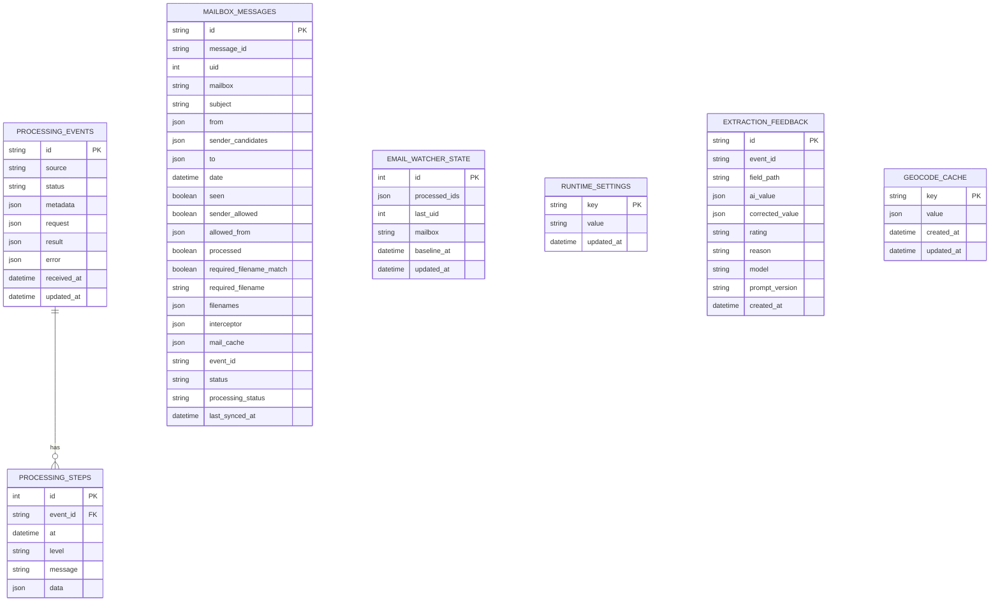

# Database Schema

Astebook uses PostgreSQL with Prisma migrations.

Runtime deployment is managed by `docker-compose.yml`:

- `db`: PostgreSQL 17 with persistent data in Docker named volume `postgres_data_v17`.
- `app`: runs `prisma migrate deploy` before starting the Node server.

The initial database prepares durable tables for operational state. Mailbox listing is DB-backed in production: the IMAP watcher inserts or updates `mailbox_messages`, and the admin listing reads that table instead of opening a live IMAP listing.

## Connection

Default Docker connection:

```text
postgresql://astebook:astebook@db:5432/astebook?schema=public
```

CI uses the same credentials against the GitHub Actions PostgreSQL service on `localhost`.

## Prisma

- Schema: `prisma/schema.prisma`
- Migrations: `prisma/migrations`
- Apply migrations: `npm run db:migrate`
- Generate client: `npm run db:generate`

Backend entry points:

- `backend/lib/db.js`: Prisma client singleton.
- `backend/lib/processing_log.js`: processing events and steps persistence.
- `backend/lib/app_config.js`: runtime settings via DB table or JSON fallback.
- `backend/lib/mailbox_index.js`: DB-backed mailbox index with JSON-file fallback.
- `backend/lib/extraction_feedback.js`: feedback records via JSONL/runtime path, with API exposure.

## Runtime Storage

- Production with `DATABASE_URL` uses PostgreSQL for Prisma-backed features.
- Local/dev without `DATABASE_URL` uses JSON fallbacks in `runtime/` for app config, processing logs and mailbox index.
- Docker Compose provisions PostgreSQL 17 with named volume `postgres_data_v17`.
- The app startup command runs `prisma migrate deploy` before `backend/server.js`.
- GitHub Actions starts PostgreSQL and runs `npm run db:migrate` before lint/build/tests.
- Tests that import `backend/server.js` and reach Prisma-backed processing-event paths require a usable `DATABASE_URL`.

## Tables



## Migration Policy

Current migration folders:

- `20260717154000_init_postgresql`
- `20260717180500_remove_mailbox_ignore_before`
- `20260720092000_add_mailbox_message_cache`
- `20260721172000_email_watcher_last_uid`

Schema changes require:

- a Prisma migration;
- an update to this file;
- a CI run that applies migrations against PostgreSQL;
- a deploy through the standard pipeline so `prisma migrate deploy` runs before the app starts.
